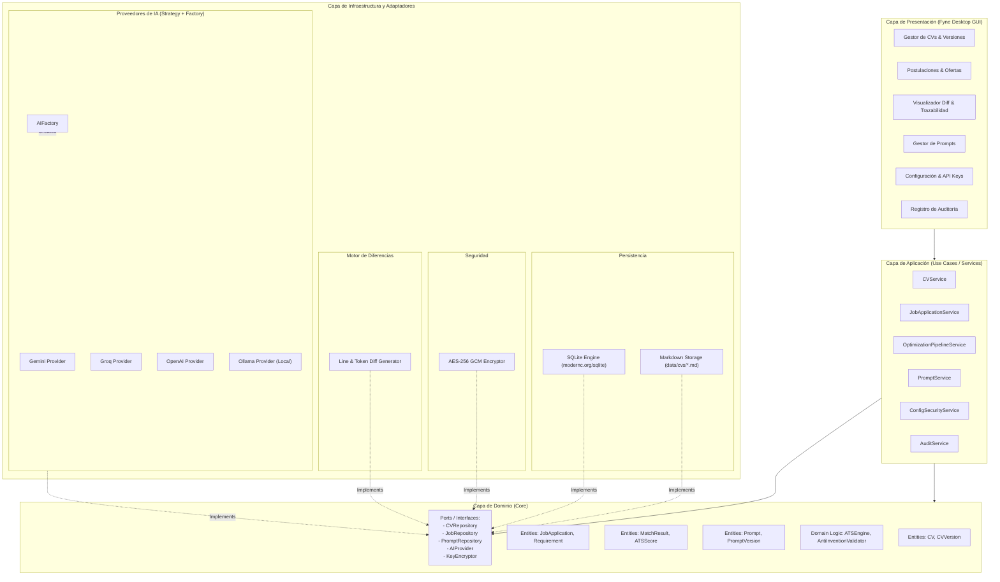
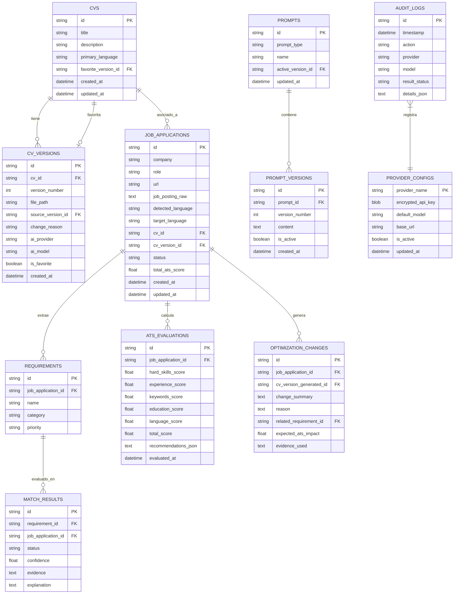
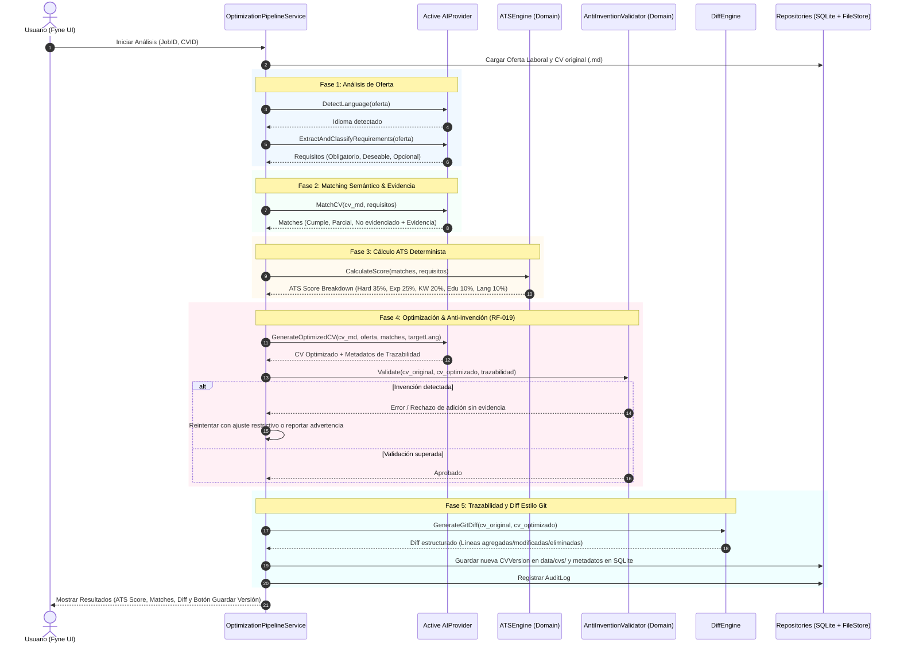

# Arquitectura del Sistema - CV Checker (V1)
## Sistema de Optimización Inteligente de CV para Postulaciones Laborales

---

## 1. Visión General y Objetivos Arquitectónicos

El sistema **CV Checker** es una aplicación de escritorio multiplataforma (Windows, Linux, macOS) desarrollada en **Go** utilizando la librería gráfica **Fyne**. Su objetivo es permitir la gestión de currículums en formato Markdown, el análisis inteligente de ofertas de empleo y la optimización explicable y trazable del CV adaptado a cada postulación mediante Inteligencia Artificial, asegurando total privacidad de datos y control local.

### Principios de Diseño
1. **100% Almacenamiento Local (Privacy-First):** Ningún dato de CV, oferta, historial o configuración sale a la nube de terceros, excepto las llamadas necesarias a las APIs de los LLMs seleccionados por el usuario.
2. **Arquitectura Hexagonal / Limpia (Clean Architecture):** Desacoplamiento estricto entre UI, Casos de Uso, Entidades de Negocio, Persistencia y Proveedores de IA.
3. **Desacoplamiento de Proveedores de IA (Strategy + Factory):** Intercambiabilidad en tiempo de ejecución entre Gemini, Groq, OpenAI y Ollama sin recompilar ni alterar la lógica de negocio.
4. **Resiliencia y Concurrencia Responsiva:** Las llamadas de red a LLMs son asíncronas y cancelables; la UI de Fyne permanece fluida y los fallos de IA no comprometen la integridad de la base de datos ni los archivos físicos.
5. **Anti-Invención y Trazabilidad:** Cada cambio propuesto debe estar respaldado por evidencia preexistente en el CV de origen.

---

## 2. Diagrama de Arquitectura de Alto Nivel



---

## 3. Estructura de Directorios del Proyecto

Se adopta la convención estándar de proyectos Go (`Standard Go Project Layout`):

```text
cv-checker/
├── cmd/
│   └── cvchecker/
│       └── main.go                 # Punto de entrada, bootstrap e inyección de dependencias
├── internal/
│   ├── domain/                     # Capa de Dominio (Pura, sin dependencias externas)
│   │   ├── cv.go                   # Entidades CV, CVVersion
│   │   ├── job.go                  # Entidades JobApplication, Requirement, RequirementCategory
│   │   ├── ats.go                  # Entidades MatchResult, ATSScore, Pesos y cálculo
│   │   ├── prompt.go               # Entidades Prompt, PromptType, Version
│   │   ├── audit.go                # Entidades AuditLog
│   │   ├── validator.go            # Reglas Anti-Invención
│   │   ├── ports.go                # Interfaces (Repositories, AIProvider, Cipher, Diff)
│   │   └── errors.go               # Errores de dominio tipados
│   │
│   ├── app/                        # Capa de Aplicación (Casos de Uso)
│   │   ├── cv_service.go           # CRUD de CVs, clonado, favoritos, versiones
│   │   ├── job_service.go          # Gestión de ofertas laborales y postulaciones
│   │   ├── optimization_pipeline.go# Orquestador del flujo IA (Análisis -> Match -> ATS -> Optimización)
│   │   ├── prompt_service.go       # Versionado, rollback y catálogo de prompts
│   │   ├── config_service.go       # Configuración de proveedores y llaves API
│   │   └── audit_service.go        # Registro de acciones y trazabilidad
│   │
│   ├── infrastructure/             # Adaptadores de Infraestructura
│   │   ├── persistence/
│   │   │   ├── sqlite/             # Driver SQLite (modernc.org/sqlite sin CGO)
│   │   │   │   ├── db.go           # Conexión, migrations y transacciones
│   │   │   │   ├── migrations/     # Scripts SQL DDL
│   │   │   │   ├── cv_repo.go      # Implementación de CVRepository
│   │   │   │   ├── job_repo.go     # Implementación de JobRepository
│   │   │   │   ├── prompt_repo.go  # Implementación de PromptRepository
│   │   │   │   └── audit_repo.go   # Implementación de AuditRepository
│   │   │   └── filestore/
│   │   │       └── md_store.go     # Lectura y escritura de data/cvs/*.md
│   │   │
│   │   ├── security/
│   │   │   └── aes_gcm.go          # Cifrado/Descifrado AES-256 GCM para API keys
│   │   │
│   │   ├── diff/
│   │   │   └── git_diff.go         # Algoritmo de diff unificado estilo Git
│   │   │
│   │   └── ai/                     # Proveedores de IA
│   │       ├── factory.go          # AIProviderFactory
│   │       ├── common.go           # Tipos de respuesta JSON esperados y prompts base
│   │       ├── gemini.go           # Adaptador Google Gemini API
│   │       ├── groq.go             # Adaptador Groq API
│   │       ├── openai.go           # Adaptador OpenAI API
│   │       └── ollama.go           # Adaptador Ollama API (HTTP local)
│   │
│   └── ui/                         # Capa de Presentación (Fyne GUI)
│       ├── app.go                  # Inicialización de la ventana Fyne, temas y menú
│       ├── async.go                # Helpers para ejecución en goroutines y fyne.Do
│       ├── components/             # Componentes reusables (score badges, diff viewer, chips)
│       ├── views/                  # Vistas principales
│       │   ├── cv_manager.go       # Lista, editor Markdown y árbol de versiones
│       │   ├── job_manager.go      # Gestión y formulario de postulaciones
│       │   ├── analysis_view.go    # Vista de matching, requisitos y ATS Score
│       │   ├── diff_view.go        # Vista comparativa con trazabilidad de cambios
│       │   ├── prompt_manager.go   # Catálogo y editor de versiones de prompts
│       │   ├── settings_view.go    # Selección de proveedor IA, modelos y API keys
│       │   └── audit_view.go       # Historial de actividades
│       └── theme/                  # Paleta de colores, tipografías e iconos
│
├── data/
│   └── cvs/                        # Almacenamiento local de archivos *.md
├── docs/
│   ├── requirements.md             # Requisitos funcionales y no funcionales
│   └── architecture.md             # Este documento
├── go.mod
└── go.sum
```

---

## 4. Modelo de Datos y Esquema SQLite

Se emplea **SQLite** (mediante el driver en Go puro `modernc.org/sqlite`, garantizando portabilidad sin CGO para Windows, Linux y macOS).



### Separación de Metadatos y Contenido Físico (RF-002)
- La base de datos almacena metadatos estructurados y rutas relativas.
- El contenido completo de cada versión del CV reside en disco:
  `data/cvs/{cv_id}_v{version_number}.md`.
- El acceso a estos archivos se abstrae detrás del puerto `CVFileStore`.

---

## 5. Diseño del Módulo de IA (Strategy + Factory)

### 5.1 Interfaz de Dominio (`AIProvider`)

Para cumplir con **RF-030 a RF-033** y **RNF-005**, la lógica de negocio solo conoce la siguiente interfaz desacoplada:

```go
package domain

import "context"

type AIProvider interface {
    // DetectLanguage identifica el idioma principal del texto (RF-009)
    DetectLanguage(ctx context.Context, text string) (Language, error)

    // ExtractAndClassifyRequirements extrae requisitos obligatorios, deseables y opcionales (RF-010, RF-011)
    ExtractAndClassifyRequirements(ctx context.Context, jobPosting string, prompt string) ([]Requirement, error)

    // MatchCV compara el contenido del CV contra los requisitos de la oferta (RF-012, RF-013, RF-014)
    MatchCV(ctx context.Context, cvContent string, requirements []Requirement, prompt string) ([]MatchResult, error)

    // GenerateRecommendations genera sugerencias, riesgos y keywords ATS (RF-018)
    GenerateRecommendations(ctx context.Context, cvContent string, matches []MatchResult, prompt string) (Recommendations, error)

    // GenerateOptimizedCV produce el nuevo markdown optimizado junto con el desglose de trazabilidad (RF-020, RF-022, RF-024)
    GenerateOptimizedCV(ctx context.Context, cvContent string, jobPosting string, matches []MatchResult, targetLang Language, prompt string) (OptimizedCVResult, error)

    // ProviderName retorna el identificador del proveedor
    ProviderName() string
}
```

### 5.2 Estructuras de Salida Tipadas y Salidas Estructuradas (JSON Schema)
Para asegurar que los LLMs respondan sin ambigüedades, todas las llamadas utilizan formatos estructurados (JSON Schema) en sus prompts del sistema:

```json
{
  "requirements": [
    {
      "nombre": "Go",
      "categoria": "hard_skill",
      "prioridad": "obligatorio"
    }
  ],
  "matching": [
    {
      "requisito": "Docker",
      "estado": "Cumple parcialmente",
      "confianza": 0.85,
      "evidencia": "Menciona experiencia con contenedores Linux en proyecto anterior",
      "explicacion": "No cita Dockerfile explícitamente pero conoce el ecosistema de contenedores."
    }
  ]
}
```

### 5.3 Implementaciones de Proveedores
1. **Gemini (`internal/infrastructure/ai/gemini.go`):**
   - Utiliza el SDK oficial o cliente HTTP directo para Gemini 1.5/2.0 Flash / Pro.
   - Excelente para respuestas JSON estructuradas con `response_schema`.
2. **Groq (`internal/infrastructure/ai/groq.go`):**
   - Implementa llamadas ultrarrápidas mediante API compatible con OpenAI para modelos Llama 3, Mixtral, DeepSeek.
3. **OpenAI (`internal/infrastructure/ai/openai.go`):**
   - Soporte para GPT-4o / GPT-4o-mini con modo JSON estricto (`response_format`).
4. **Ollama (`internal/infrastructure/ai/ollama.go`):**
   - Conexión HTTP local (`http://localhost:11434/api/chat`).
   - Permite ejecución 100% offline (sin clave de API ni salida a internet).

### 5.4 Factory y Cambio Dinámico en Caliente (RF-031)
```go
type AIFactory struct {
    configRepo ConfigRepository
    encryptor  KeyEncryptor
}

func (f *AIFactory) GetActiveProvider(ctx context.Context) (domain.AIProvider, error) {
    activeConfig, err := f.configRepo.GetActiveConfig(ctx)
    if err != nil {
        return nil, err
    }
    apiKey, err := f.encryptor.Decrypt(activeConfig.EncryptedAPIKey)
    if err != nil && activeConfig.Provider != "ollama" {
        return nil, err
    }

    switch activeConfig.Provider {
    case "gemini":
        return NewGeminiProvider(apiKey, activeConfig.Model), nil
    case "groq":
        return NewGroqProvider(apiKey, activeConfig.Model), nil
    case "openai":
        return NewOpenAIProvider(apiKey, activeConfig.Model), nil
    case "ollama":
        return NewOllamaProvider(activeConfig.BaseURL, activeConfig.Model), nil
    default:
        return nil, ErrUnsupportedProvider
    }
}
```

---

## 6. Pipeline de Optimización y Motor ATS Explicable

### 6.1 Pipeline Paso a Paso



### 6.2 Motor ATS y Pesos Fijos (RF-015, RF-016, RF-017)
El cálculo del ATS Score se realiza en el dominio mediante lógica **determinista y explicable** (no es un número inventado arbitrariamente por el LLM):

$$\text{ATS Total} = 0.35 \times S_{\text{hard}} + 0.25 \times S_{\text{exp}} + 0.20 \times S_{\text{kw}} + 0.10 \times S_{\text{edu}} + 0.10 \times S_{\text{lang}}$$

Donde cada subscore de categoría $S_{\text{cat}}$ se calcula a partir de los requisitos de esa categoría:
- **Cumple:** 100% del valor ponderado del requisito.
- **Cumple parcialmente:** Factor de confianza (ej. 50% - 75% según `confidence`).
- **No evidenciado:** 0%.
- Requisitos con prioridad **obligatorio** penalizan doblemente si no están evidenciados.

### 6.3 Restricción Anti-Invención (RF-019)
Para garantizar el cumplimiento estricto de la regla anti-alucinaciones:
1. **Prompt Constraint:** Regla estricta a nivel del system prompt prohibiendo agregar habilidades, fechas, empresas o títulos que no deriven de la evidencia preexistente.
2. **Domain Validator (`AntiInventionValidator`):**
   - Extrae los cambios entre el CV original y el optimizado.
   - Si se añade una entidad nueva (ej. "Kubernetes"), verifica que la lista de trazabilidad (`TraceableChange`) justifique que el CV original ya contenía evidencia implícita (ej. "Contenedores Docker en producción").
   - Si no existe evidencia correlacionada, la aplicación marca el cambio como una alerta visual de riesgo alto para que el usuario decida si aceptarlo o rechazarlo.

---

## 7. Versionado de Prompts (RF-025 a RF-029)

El sistema trata a los prompts como artefactos de primer nivel versionados en SQLite:
1. **Catálogo de Tipos de Prompts:**
   - `JOB_ANALYSIS` (Extracción y clasificación de requisitos)
   - `CV_MATCHING` (Comparación y cálculo de evidencia)
   - `ATS_SCORING` (Explicabilidad y scoring)
   - `TRANSLATION` (Traducción preservando contexto técnico)
   - `CV_OPTIMIZATION` (Reescritura de viñetas y resumen con trazabilidad)
2. **Ciclo de Vida:**
   - Cada tipo tiene múltiples versiones (`v1`, `v2`, `v3`).
   - Solo una versión puede marcarse con `is_active = true`.
   - Si el usuario edita un prompt, el sistema genera una nueva versión `v(n+1)`.
   - Permite consultar historial, comparar diffs entre versiones de prompts y hacer rollback a versiones anteriores con 1 clic.
   - En la primera ejecución, la base de datos se precarga con los prompts por defecto (Seed data).

---

## 8. Arquitectura de UI (Fyne Desktop) y Concurrencia

### 8.1 Patrón de UI y Reactividad
Fyne funciona sobre un hilo principal para renderizado. Para evitar bloqueos de la interfaz durante las llamadas a la IA (que pueden durar 5-45 segundos):

1. **Gestión de Concurrencia:**
   - Todo llamado al pipeline de IA se despacha en una `goroutine` con `context.WithTimeout(ctx, 60*time.Second)`.
   - La actualización visual se ejecuta de forma segura en el hilo de UI mediante `fyne.Do(func() { ... })`.
   - La pantalla muestra un componente `ProgressBarInfinite` o indicador de carga con el paso actual (ej: *"Analizando requisitos de la oferta (Paso 1/4)..."*).
   - Se incluye un botón de cancelación que invoca `cancelFunc()`, liberando recursos de inmediato.

2. **Componente de Diff Estilo Git (RF-023):**
   - Componente personalizado en Fyne que renderiza líneas eliminadas en fondo rojo suave (`-`) y líneas añadidas/optimizadas en fondo verde suave (`+`).
   - Cada bloque modificado incluye un tooltip o panel lateral interactivo con la **trazabilidad**: motivo, impacto estimado en ATS y evidencia origen.

### 8.3 Estándar de Accesibilidad, Formularios y Etiquetado de Campos (RF-037)
Para garantizar una experiencia de usuario clara, predecible y accesible:
1. **Etiquetado Obligatorio (No Unlabelled Inputs):** Todo control de entrada (`widget.Entry`, `widget.Select`, `widget.Check`, áreas de texto) debe estar emparejado con una etiqueta descriptiva visible. En formularios estructurados se utiliza `widget.NewForm` con `widget.NewFormItem("Etiqueta:", control)`.
2. **Textos de Ayuda y Marcadores de Posición (`Placeholders`):** Todo campo de texto libre debe incluir un `placeholder` con ejemplos contextuales del formato o información requerida (ej. *"Ej: Senior Backend Engineer Go..."*, *"https://empresa.com/careers/job-123 (opcional)"*).
3. **Secciones de Contenido Extenso:** Las áreas de texto multilínea (anuncio laboral, contenido markdown, instrucciones de prompts) deben contar con un encabezado de sección explícito (`widget.NewLabelWithStyle`) inmediatamente superior indicando el propósito y formato esperado.

---

## 9. Seguridad y Cifrado (AES-256 GCM) (RNF-007, RF-035)

### 9.1 Almacenamiento Seguro de Llaves API
1. Las API Keys no se almacenan nunca en texto plano.
2. Se utiliza el algoritmo **AES-256 GCM** (Galois/Counter Mode) que proporciona confidencialidad e integridad autenticada.
3. **Derivación de la Llave de Cifrado (Master Key):**
   - Una llave maestra de 256 bits derivada localmente mediante **Argon2id** / **PBKDF2** combinando un identificador de máquina único del usuario (`machine-id` de `/etc/machine-id` en Linux o UUID en Windows/macOS) con un salt aleatorio generado en la instalación inicial (`data/.app.salt`).
   - De forma opcional, el usuario puede ingresar una contraseña maestra al iniciar la app.
4. Las llaves cifradas se almacenan en la tabla `provider_configs.encrypted_api_key`.

---

## 10. Auditoría y Trazabilidad (RF-036, RNF-011)

Cada operación crítica registra una entrada inmutable en la tabla `audit_logs`:
- Timestamp (UTC)
- Acción ejecutada (`OPTIMIZE_CV`, `ANALYZE_JOB`, `CHANGE_PROMPT`, `UPDATE_KEY`)
- Proveedor de IA y modelo exacto utilizado
- Estado del resultado (`SUCCESS`, `FAILED`, `CANCELLED`)
- Metadatos en formato JSON (duración, tokens aproximados, ID de versión generada).

---

## 11. Estrategia de Compilación y Portabilidad (RNF-001, RNF-014)

1. **Go Toolchain:** Go 1.22+ (actualmente Go 1.27 en el entorno).
2. **CGO y SQLite:** Al utilizar `modernc.org/sqlite` (implementación de SQLite traducida a Go puro), no se requiere toolchain de C para la base de datos.
3. **Fyne GUI:** Para Fyne en Linux se requiere la librería OpenGL del sistema (`libgl1-mesa-dev`, `xorg-dev`). Para compilación cruzada hacia Windows y macOS se emplea `fyne-cross` o compilación nativa en pipelines de CI (GitHub Actions).

---

## 12. Plan de Implementación por Fases (Roadmap V1)

| Fase | Alcance | Hitos / Entregables |
| :--- | :--- | :--- |
| **Fase 1: Fundación y Dominio** | Modelos, Persistencia y Cifrado | - Entidades de dominio y puertos (`ports.go`).<br>- Migraciones SQLite y repositorios en Go puro.<br>- Gestor de archivos Markdown (`data/cvs/`).<br>- Módulo de cifrado AES-256 GCM. |
| **Fase 2: Motor de Proveedores IA** | Integración y Factoría de LLMs | - Interfaz `AIProvider` y `AIFactory`.<br>- Implementación de clientes para Gemini, Groq, OpenAI y Ollama.<br>- Catálogo de prompts base y versionado en BD.<br>- Pruebas unitarias e integración con mocks. |
| **Fase 3: Lógica de Análisis y ATS** | Pipeline y Anti-Invención | - Extractor de requisitos y clasificador.<br>- Motor de matching semántico con equivalencias.<br>- Algoritmo de score ATS explicable.<br>- Validador anti-invención de experiencias. |
| **Fase 4: Motor de Diff y Optimización** | Trazabilidad y Generación | - Generador de CV optimizado y traductor.<br>- Generador de Diff unificado estilo Git.<br>- Vinculación de trazabilidad de cambios por requisito. |
| **Fase 5: Interfaz de Usuario (Fyne)** | Pantallas y Componentes | - Navegación principal y temas.<br>- Gestor de CVs y visualizador/editor Markdown.<br>- Gestor de Postulaciones y visualizador ATS.<br>- Comparador Diff visual con trazabilidad.<br>- Pantallas de configuración de APIs, Prompts y Auditoría. |
| **Fase 6: Integración y Calidad** | Pruebas y Empaquetado | - Pruebas de estrés y límites de rendimiento (< 60s).<br>- Auditoría de seguridad y persistencia local.<br>- Verificación de criterios de éxito V1. |
